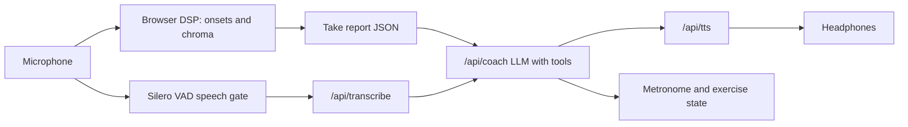

# Woodshed

A voice-first guitar practice coach. Both hands stay on the guitar: you talk to the coach, it listens to you play, and it tells you what to fix.

Built for the Hiya Voice AI Challenge, Real-Time Assistance track.

## Why voice

When you practice guitar, both hands are on the instrument and your eyes are on the fretboard. Every time you reach for a screen to slow down, repeat a section or start the next exercise, you break the flow you are trying to build. Music has always been taught out loud: a teacher counts you in, listens, and tells you what to change. Woodshed keeps that whole loop in voice, so you never have to let go of the guitar.

## What it does

1. You start an exercise by voice, for example "Let's practice C to G at 70". The coach counts you in and the metronome starts.
2. You play 8 bars. In the browser, Woodshed measures every strum: how early or late it landed against the beat, and whether the right chord rang.
3. When the take ends, the coach gives you one concrete correction based on those measurements and your previous takes.
4. You answer ("OK, slower"), the coach adjusts the tempo or the exercise, and the next take starts.

## Requirements

- Node.js 20.9 or newer, and npm
- Desktop Google Chrome
- A microphone. Headphones are strongly recommended, so the coach's voice doesn't leak back into the microphone.
- An OpenAI API key from [platform.openai.com/api-keys](https://platform.openai.com/api-keys). The account needs available credit, otherwise every request fails.
- A guitar is optional: Demo mode plays a synthesized guitar instead.

## Setup

1. Clone the repository or unzip the submission, then open a terminal in the project folder.
2. Install the dependencies:

   ```bash
   npm install
   ```

3. Create your local environment file from the example.

   Windows (PowerShell):

   ```powershell
   Copy-Item .env.example .env.local
   ```

   macOS or Linux:

   ```bash
   cp .env.example .env.local
   ```

4. Open `.env.local` and set your key:

   ```bash
   OPENAI_API_KEY=sk-your-key
   ```

5. Start the development server:

   ```bash
   npm run dev
   ```

6. Open [http://localhost:3000](http://localhost:3000) in Chrome and allow microphone access.

## Using it

### With a guitar

1. Put on headphones and click **Start** once. Browsers only allow audio to start after a user gesture; after this one click, everything is voice.
2. Say what you want to practice, for example "Let's practice C to G at 70".
3. Play when the count-in ends. After 8 bars, the coach tells you what to fix.
4. Talk back to adjust the next take.

### Without a guitar (Demo mode)

Turn on **Demo mode** to let a synthesized guitar play the exercise into the same analyzer the microphone uses. Two sliders inject mistakes:

- **Timing sloppiness:** strums land randomly early or late.
- **Late chord changes:** the guitarist switches to the next chord too late.

You still talk to the coach through your microphone, exactly as you would with a real guitar.

## Example voice commands

- "Let's practice C to G at 70."
- "Slower." or "Speed it up a bit."
- "Again."
- "Loop it."
- "Why was that bad?"
- "Stop."

## How it works

The microphone signal goes two ways:

- **Music analysis** runs continuously in the browser. It detects each strum (onset detection) and which chord rang (chroma template matching against the chords of the current exercise).
- **Speech** only gets through when a voice activity detector (Silero VAD, also running in the browser) classifies the sound as speech. That way strumming doesn't trigger commands.

At the end of each take, the analyzer produces a small JSON report. The coach is an LLM behind a Next.js API route. It receives the report, your previous takes and what you just said, answers in one or two spoken sentences, and uses tool calls to change the tempo, switch the exercise, or start and stop takes.

The DSP measures, the LLM teaches: the model never hears your playing, it only gets the numbers.



The OpenAI API key stays on the server: the browser only talks to the local API routes.

## Troubleshooting

- **No microphone input.** Chrome may have blocked the permission. Click the icon on the left side of the address bar, allow the microphone, and reload the page.
- **The coach reacts to guitar sounds.** Use headphones, and lower the microphone input level in your system's sound settings.
- **The coach doesn't speak.** Click anywhere on the page once. Chrome blocks audio until the page has received a click.
- **API requests fail with 401.** The key in `.env.local` is wrong or missing. Restart `npm run dev` after editing `.env.local`, because the file is only read at startup.
- **API requests fail with 429.** The OpenAI account has no available credit, or it hit a rate limit.

## Privacy

The music analysis runs entirely in your browser. Audio only leaves your machine when the voice detector thinks you are speaking: those segments are sent to OpenAI for transcription. The take reports sent to the coach are text.

## More

- The one-page write-up is submitted alongside this repository.
- [ai.md](ai.md) describes which AI tools were used to build Woodshed, and which AI runs inside it.
