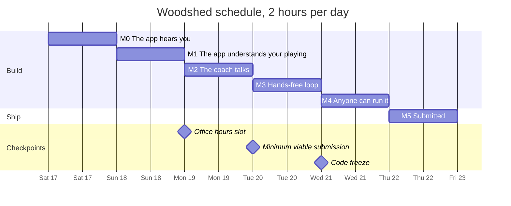
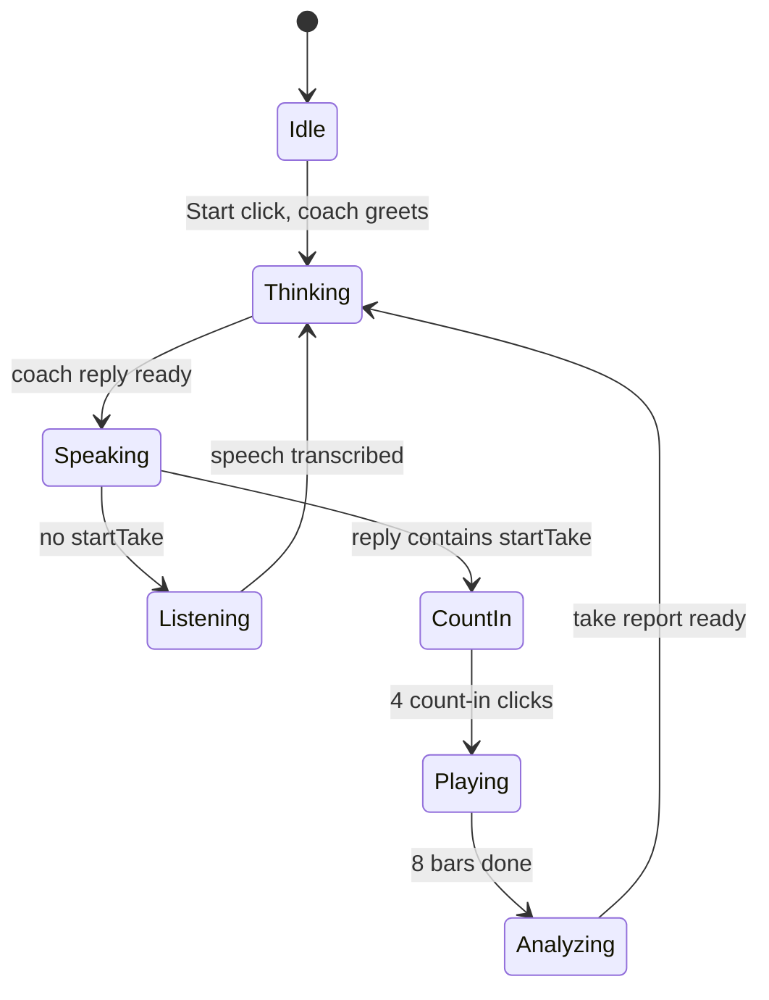

# Woodshed roadmap

How Woodshed gets built between Saturday, October 17 and Thursday, October 22, 2026: the milestones, the micro-steps inside each one, what gets tested along the way, and what gets cut if time runs out. This is a living document: tick the checkboxes as steps land, and record test results in the [test log](#test-log).

## Constraints

- **Time:** about 2 hours per day, 6 sessions, roughly 12 hours in total. Every session below is budgeted to fit into 120 minutes.
- **Deadline:** Thursday, October 22, 23:59 CEST. The target is to submit at least 2 hours earlier.
- **Test setup:** acoustic guitar recorded through an external microphone (USB or headset), Chrome on the desktop.
- **Deliverables:** a one-page write-up, the code with `README.md` and `ai.md`, and an optional 2-3 minute demo video (we will record one).
- **Way of working:** the project rule in `.cursor/rules/woodshed.mdc` applies: one micro-step at a time, test it, commit it, then move on.

## Milestones at a glance

| | Day | Milestone | What is true at the end |
|---|---|---|---|
| M0 | Sat, Oct 17 | The app hears you | `npm run dev` works, the guitar moves a level meter, and mic processing is verified off. |
| M1 | Sun, Oct 18 | The app understands your playing | After an 8-bar take with a real guitar, a JSON report shows timing and chords per beat. |
| M2 | Mon, Oct 19 | The coach talks | After every take, the coach speaks one concrete correction. |
| M3 | Tue, Oct 20 | Hands-free (minimum viable submission) | After one click on Start, the whole practice loop runs by voice. |
| M4 | Wed, Oct 21 | Anyone can run it | Demo mode works without a guitar, a fresh clone runs by following the README, and the code is frozen. |
| M5 | Thu, Oct 22 | Submitted | The video, write-up and final `ai.md` are done, and the submission is in on Ashby. |



## Key decisions

These decisions are what make the scope fit into 12 hours. Each one has a reason and a known trade-off.

1. **Half-duplex turn-taking: you play, then you talk.** The app only listens for speech between takes. A take is a fixed 8 bars (about 27 seconds at 70 BPM) and ends on its own.
   - *Why:* it removes the hardest problem, separating speech from guitar on one microphone. It matches how real lessons work, and the coach's voice never overlaps with the analysis.
   - *Trade-off:* you can't say "stop" in the middle of a take. That goes into "what I'd do next".
2. **The DSP measures, the LLM teaches.** Strum timing and chord detection are deterministic and run in the browser. The LLM only receives a JSON report, never audio of the playing.
3. **The coach returns structured output instead of tool calls.** Every coach reply is one JSON object: `{ say, startTake }`. One round trip gives both the sentence to speak and the action, which is faster and simpler to parse than a tool call followed by a second request for text.
   - The README and `ai.md` currently say "tool calls"; this gets aligned in step 4.6.
4. **One fixed exercise format.**
   - 4/4 time, one down-strum per beat, and the chord changes every bar, cycling through the exercise's chords.
   - 8 bars per take, at 40-140 BPM.
   - Supported chords: C, D, E, G, A, Am, Dm, Em.
   - The default exercise is C to G at 70 BPM.
5. **Short-term memory only.** The last 5 take summaries are kept in memory and sent with each coach request. There is no database and no `localStorage` (cross-session memory is a "could" item).
6. **One native `AudioContext` for everything.** It is created once and handed to Tone.js with `Tone.setContext(ctx)`. The mic source and Meyda use the same context. Mixing Tone's wrapped context with native nodes is a common source of `InvalidAccessError`.
7. **Microphone latency is calibrated away per take.** The median strum offset is subtracted, so timing is reported relative to your own average.
   - *Trade-off:* a player who is consistently late by the same amount looks "on time". For coaching consistency and chord changes, that is acceptable.
8. **Desktop Chrome only, English UI and coach.**
9. **Libraries:**
   - Next.js (App Router, TypeScript, Tailwind),
   - Tone.js (metronome, demo guitar),
   - Meyda (RMS and chroma features),
   - `@ricky0123/vad-web` (Silero VAD),
   - the official `openai` SDK inside the API routes,
   - Vitest for a few unit tests.

## Architecture

### Session state machine

The VAD is active only in `Listening`. It is paused in every other state, including while the coach is speaking, so the app never transcribes its own voice.



### Planned file layout

```text
app/
  page.tsx                    UI shell: Start button, status, panels
  api/transcribe/route.ts     audio segment -> text
  api/coach/route.ts          report + history + utterance -> { say, startTake }
  api/tts/route.ts            text -> mp3
components/
  LevelMeter.tsx              input level, peak, clipping, noise floor
  BeatGrid.tsx                8 x 4 grid of the last take
  ConversationLog.tsx         what you said, what the coach said
  DemoPanel.tsx               demo mode toggle and two sliders
lib/
  config.ts                   server-side config: API key, model names
  types.ts                    shared types (Exercise, StrumResult, TakeReport)
  audio/context.ts            the single AudioContext, shared with Tone.js
  audio/mic.ts                getUserMedia with processing disabled
  audio/metronome.ts          count-in, clicks, beat times
  audio/demoGuitar.ts         synthesized guitar with injectable mistakes
  analysis/features.ts        Meyda frames (rms, chroma) with timestamps
  analysis/onsets.ts          strum detection
  analysis/chords.ts          chord templates and matching
  analysis/report.ts          take report builder (pure functions)
  voice/vad.ts                MicVAD wrapper with pause and resume
  voice/client.ts             fetch helpers for the three API routes
  session/useSession.ts       the state machine as a React hook
fixtures/reports/             clean.json, late-changes.json, rushing.json
tests/                        chords.test.ts, report.test.ts
```

### Data contracts

```ts
export type ChordName = "C" | "D" | "E" | "G" | "A" | "Am" | "Dm" | "Em";

export interface Exercise {
  chords: ChordName[]; // one bar each, cycling
  bpm: number; // 40-140
  bars: number; // 8
  beatsPerBar: 4;
}

export interface StrumResult {
  bar: number; // 1-based
  beat: number; // 1-4
  expected: ChordName;
  heard: ChordName | "unclear" | "missed";
  offsetMs: number | null; // positive = late, negative = early, after latency removal
}

export interface TakeReport {
  exercise: Exercise;
  strums: StrumResult[];
  summary: {
    expectedStrums: number;
    detectedStrums: number;
    chordAccuracy: number; // 0-1
    meanAbsOffsetMs: number;
    driftMsPerBar: number; // negative = rushing
    changes: { total: number; clean: number; late: number };
    topIssue: "late-changes" | "rushing" | "dragging" | "timing" | "wrong-chords" | "none";
  };
}

// POST /api/coach
export interface CoachRequest {
  exercise: Exercise;
  latestReport: TakeReport | null;
  history: TakeReport["summary"][]; // last 5
  userSaid: string | null;
}

export interface CoachResponse {
  say: string; // at most 2 sentences
  startTake: { chords: ChordName[]; bpm: number } | null;
}
```

### Analysis rules

- **Strum to beat mapping.** Each beat owns a window from half a beat before to half a beat after its click. The first onset in the window belongs to that beat; further onsets count as extras; an empty window is `missed`.
- **Chord per strum.** Average the chroma over 60-250 ms after the onset, which skips the attack transient. Compare it with binary triad templates using cosine similarity, and return `unclear` below a threshold that gets tuned in T4.
- **Late change.** At the first beat of a bar whose chord differs from the previous bar, the change is late if:
  - the heard chord is the previous chord, `unclear` or `missed`,
  - or the strum is more than 120 ms late.
- **`topIssue`** is ranked deterministically in this order: late changes, rushing, dragging, general timing, wrong chords, none. The LLM phrases the issue; it doesn't pick it. This keeps the coach from inventing problems.

## How each session runs

1. Open this file and pick the next unchecked micro-step.
2. The agent implements exactly that step, as complete files.
3. You run the test listed for the step and report the result.
4. Commit with the suggested message, for example `m1.4: onset detector`.
5. Tick the checkbox and move to the next step.
6. At the end of the session, add one line to the `ai.md` development log, and update the test log here.

## M0: The app hears you (Saturday, October 17)

**Goal:** the project runs, the mic captures the raw guitar signal, and you can see it.

- [x] **0.0 OpenAI key (before the session, 10 min).** Create an OpenAI account, add credit, create an API key, and set a monthly budget limit. Billing can take a while, so do this tonight.
- [x] **0.1 Scaffold Next.js (20 min).** `create-next-app` refuses non-empty folders, so:
  - scaffold into `_scaffold/` with TypeScript, App Router, Tailwind, ESLint and no `src` directory,
  - move everything into the root except its `README.md`, then delete `_scaffold/`,
  - merge `.gitignore`. Next's template ignores `.env*`, so add `!.env.example`.
  - *Test:* `npm run dev` serves the default page; T0.
- [x] **0.2 Dependencies (10 min).** `npm install tone meyda @ricky0123/vad-web openai`, and `npm install -D vitest`. *Test:* `npm run build` passes.
- [x] **0.3 Config (10 min).**
  - `.env.example` with `OPENAI_API_KEY=`.
  - [lib/config.ts](lib/config.ts) with a `getOpenAIKey()` that throws a readable error ("OPENAI_API_KEY is missing, see README") when the key isn't set.
- [x] **0.4 Audio context and Start button (20 min).** [lib/audio/context.ts](lib/audio/context.ts) creates the single native `AudioContext` and passes it to Tone.js. The Start button on [app/page.tsx](app/page.tsx) resumes it. *Test:* after the click, `ctx.state` is `running`.
- [x] **0.5 Raw microphone (15 min).** [lib/audio/mic.ts](lib/audio/mic.ts) calls `getUserMedia` with `echoCancellation`, `noiseSuppression` and `autoGainControl` all set to `false`. *Test:* T1a.
- [x] **0.6 Level meter (20 min).** [components/LevelMeter.tsx](components/LevelMeter.tsx) shows RMS, peak, a clipping warning and the measured noise floor. *Test:* T1b, T1c.
- [x] **0.7 Housekeeping (5 min).**
  - Decide whether to commit `.cursor/rules/woodshed.mdc` (`ai.md` links to it).
  - Add the dev log line, tick this list.

**Exit criteria:** T0 and T1 pass, everything is committed. **Budget:** 100 minutes plus 20 minutes of buffer.

## M1: The app understands your playing (Sunday, October 18)

**Goal:** an 8-bar take with a real guitar produces a correct JSON report. This is the riskiest milestone. If one session is worth extending, it is this one.

**Change of plan (2026-10-17):** no guitar until Monday or Tuesday.
- The demo guitar (4.1) moves into M1, right after the metronome (1.2). The analyzer is built and tested against a synthesized guitar that plays exactly on the click, with known, injected mistakes.
- Step 1.8 and the T1b and T1c tests move to the first session with the guitar. The synthesized guitar sounds cleaner than a real acoustic one, so expect to retune the onset and chord thresholds then.
- Budget: Sunday grows by about 20 minutes (35 for 4.1, minus 15 for 1.8).

- [x] **1.1 Shared types (10 min).** [lib/types.ts](lib/types.ts) with the contracts above.
- [x] **1.2 Metronome (20 min).** [lib/audio/metronome.ts](lib/audio/metronome.ts):
  - an accented 4-click count-in, then 8 bars of clicks,
  - it returns the scheduled beat times in `AudioContext` seconds,
  - a temporary "Test take" button triggers it.
  - *Test:* the clicks are steady and stop after 8 bars.
- [x] **1.3 Feature stream (15 min).** [lib/analysis/features.ts](lib/analysis/features.ts) runs a Meyda analyzer (buffer size 512, `rms` and `chroma`) on the mic source and emits timestamped frames during a take.
- [x] **1.4 Onset detector (15 min).** [lib/analysis/onsets.ts](lib/analysis/onsets.ts) uses an adaptive threshold on the RMS rise and a 120 ms refractory period. *Test:* T2.
- [x] **1.5 Chord matcher (15 min).** [lib/analysis/chords.ts](lib/analysis/chords.ts) builds triad templates for the supported chords and matches the 60-250 ms chroma window. *Test:* T4.
- [x] **1.6 Report builder (25 min).** [lib/analysis/report.ts](lib/analysis/report.ts) maps onsets to beats, removes the median latency, assigns a chord to each beat, finds late changes, and computes the summary and `topIssue`. *Test:* T3, T5.
- [x] **1.7 Report view (5 min).** Print the last report as JSON in a `<pre>` block.
- [ ] **1.8 Real-guitar session (15 min, moved to the first session with the guitar).** Run T2-T5 and write the results into the test log. Save two real reports for the fixtures in step 2.2.

**Exit criteria:** T2-T5 pass, or the fallback from the risk list is in place. Under the change of plan, M1 exits when the demo guitar produces a correct report (T10), and T2-T5 follow with the real guitar. **Budget:** 120 minutes, no buffer.

## M2: The coach talks (Monday, October 19)

**Goal:** after every take, you hear one concrete, correct correction.

- [x] **2.1 Models (10 min).** Check the OpenAI docs for the current fast models for transcription, chat with structured outputs, and TTS. Put the defaults into [lib/config.ts](lib/config.ts), with optional environment-variable overrides.
- [x] **2.2 Fixtures (10 min).** Create `fixtures/reports/clean.json`, `late-changes.json` and `rushing.json`, reusing the real reports from 1.8 where possible.
- [x] **2.3 Coach route (30 min).** [app/api/coach/route.ts](app/api/coach/route.ts):
  - **System prompt rules:**
    - you are a friendly, direct guitar teacher,
    - at most 2 sentences and about 30 words,
    - exactly one correction or one praise,
    - only use numbers that appear in the report, and focus on `topIssue`,
    - suggest a tempo change after 2 clean takes in a row,
    - only set `startTake` when the student asked to play or agreed to.
  - **Output:** a JSON schema for `{ say, startTake }`.
  - **Server-side validation:** chords must be supported, and BPM is clamped to 40-140.
- [x] **2.4 Coach smoke test (10 min).** Post each fixture to `/api/coach` with `Invoke-RestMethod`. *Test:* T6.
- [ ] **2.5 TTS route (10 min).** [app/api/tts/route.ts](app/api/tts/route.ts) turns text into an mp3 response.
- [ ] **2.6 Client wiring (20 min).** When a take ends, call `/api/coach`, then `/api/tts`, then play the audio, with a status label (Analyzing, Thinking, Speaking). *Test:* T7a.
- [ ] **2.7 Beat grid (15 min).** [components/BeatGrid.tsx](components/BeatGrid.tsx) shows an 8 x 4 grid:
  - green: right chord, on time,
  - yellow: right chord, off time,
  - red: wrong chord, unclear or missed,
  - the expected chord labels above the bars.
- [ ] **2.8 Office hours (15 min).** Book a slot for Monday or Tuesday and prepare the pitch and questions from [Office hours prep](#office-hours-prep). The session itself is outside the 2-hour budget.

**Exit criteria:** T6 and T7a pass. **Budget:** 120 minutes.

## M3: Hands-free (Tuesday, October 20)

**Goal:** after one click on Start, the whole loop runs by voice. This is the **minimum viable submission**: from here on, there is always something worth submitting.

- [ ] **3.1 Transcription route (15 min).** [app/api/transcribe/route.ts](app/api/transcribe/route.ts) takes `FormData` with a WAV file and returns `{ text }`.
- [ ] **3.2 VAD wrapper (25 min).** [lib/voice/vad.ts](lib/voice/vad.ts):
  - `MicVAD` with `onSpeechEnd`, which encodes the segment as WAV and sends it to `/api/transcribe`,
  - exposes `pause()` and `resume()`.
  - Gotcha: `vad-web` needs its model, worklet and onnxruntime WASM files served. Point `baseAssetPath` and `onnxWASMBasePath` at the jsDelivr CDN. If that fails, copy the files into `public/`.
- [ ] **3.3 Transcript filter (5 min).** Drop empty and one-character results, and the typical noise hallucinations ("Thank you.", "you").
- [ ] **3.4 State machine (35 min).** [lib/session/useSession.ts](lib/session/useSession.ts) implements the diagram above. The VAD only runs in `Listening`, and `startTake` from the coach starts the count-in.
- [ ] **3.5 Greeting (5 min).** After Start, the coach greets you and asks what to practice.
- [ ] **3.6 Conversation log (10 min).** [components/ConversationLog.tsx](components/ConversationLog.tsx) shows every transcript and coach reply.
- [ ] **3.7 Full-loop session (25 min).** Run T7b, T8 and T9.

**Exit criteria:** T8 and T9 pass, and three takes in a row work without touching the keyboard or mouse after Start. Tag the commit `mvs`. **If this isn't done by the end of Tuesday,** Wednesday goes to finishing the loop, and demo mode moves down the [cut list](#cut-list). **Budget:** 120 minutes.

## M4: Anyone can run it (Wednesday, October 21)

**Goal:** a reviewer without a guitar can see the full loop, and a fresh clone runs by following the README.

- [x] **4.1 Demo guitar (35 min, moved to M1).** [lib/audio/demoGuitar.ts](lib/audio/demoGuitar.ts):
  - six `PluckSynth` voices, one per string. `PolySynth` doesn't accept `PluckSynth`.
  - real chord voicings, with a 12 ms strum spread,
  - two parameters: timing sloppiness (random offset of up to N ms) and late changes (strum the old chord on beat 1 of a new bar),
  - the synth goes to the speakers and, through Meyda's `setSource`, into the analyzer instead of the mic.
- [ ] **4.2 Demo panel (10 min).** [components/DemoPanel.tsx](components/DemoPanel.tsx) with a toggle and the two sliders.
- [ ] **4.3 Demo tests (10 min).** T10.
- [ ] **4.4 Error states (15 min).** Show a visible, readable message for: mic permission denied, missing API key, failed API request, rate limit.
- [ ] **4.5 Unit tests (15 min).** `tests/chords.test.ts` and `tests/report.test.ts` with synthetic inputs and the fixtures, plus an `npm test` script.
- [ ] **4.6 Docs sync (15 min).** Update [README.md](README.md) to match the real code:
  - commands, environment variables and model overrides, and the project structure,
  - the Node.js requirement: 22.12 or newer instead of 20.9, because Vitest 5 needs it,
  - only the voice commands that actually work. "Loop it" and "Stop" mid-take don't exist under the half-duplex design.
  - "tool calls" becomes "structured output".
  - Add the day's line to [ai.md](ai.md).
- [ ] **4.7 Fresh clone (15 min).** Run T11 and T12.
- [ ] **4.8 Code freeze (5 min).** Tag `v1.0`. After this, only bug fixes.

**Exit criteria:** T10-T12 pass, the docs match the code, and the tag is in place. **Budget:** 120 minutes.

## M5: Submitted (Thursday, October 22)

**Goal:** everything is in on Ashby, at least 2 hours before 23:59 CEST.

- [ ] **5.1 Demo video (45 min).** 2-3 minutes, following the [outline](#demo-video-outline). At most two full takes; upload it unlisted to YouTube or Google Drive.
- [ ] **5.2 Write-up (30 min).** One page, following the [outline](#write-up-outline). Export it to PDF if the form expects a file.
- [ ] **5.3 Final `ai.md` (10 min).** Fill in the Gemini line, finish the dev log, and add any new "where I overruled the AI" entries.
- [ ] **5.4 Publish (20 min).** Run T13, push to a public GitHub repository, then run the final check from the GitHub URL.
- [ ] **5.5 Submit (10 min).** On Ashby, submit the repo link, the write-up and the video link.
- [ ] **5.6 Buffer (5 min).**

**Budget:** 120 minutes.

## Test catalog

### Manual tests

**T0: git ignores.** `git check-ignore .env.local` prints the path. `git check-ignore .env.example` prints nothing.

**T1: Microphone.**
- *T1a:* `track.getSettings()` reports `echoCancellation`, `noiseSuppression` and `autoGainControl` as `false`.
- *T1b:* Hard strums stay below clipping (peak under 0.95).
- *T1c:* Strum RMS is at least 10 times the silent noise floor.
- Try both placements: a USB mic 20-30 cm from where the neck meets the body, and the headset mic. Write down which one you'll use.

**T2: Strum detection.**
- 16 down-strums of C at 60 BPM and 16 at 100 BPM each detect 16 strums, plus or minus 1.
- One strum left ringing for 4 beats gives exactly 1 onset.
- 10 seconds of silence gives 0 onsets.

**T3: Timing.**
- 16 steady strums with the click give a mean absolute offset of at most 40 ms after latency removal, and drift under 10 ms per bar.
- Gradually speeding up over 8 bars is reported as rushing.

**T4: Chords.**
- 20 strums of C and 20 of G: at least 18 of 20 correct for each.
- 10 strums with the fretting hand muting all strings: at least 7 come out `unclear`.
- *Informational:* 10 strums each of Am and C, which share two notes. If they get confused, keep exercises to clearly different chords and note the limitation in the write-up.

**T5: Late changes.** Play 8 bars of C to G (7 changes) and make 3 of them deliberately late. Those 3 must be flagged, with at most 1 false flag.

**T6: Coach quality.** Run each fixture 3 times. Every reply must:
- be at most 2 sentences,
- contain at least one concrete number or bar from the report,
- give exactly one tip,
- contain no numbers that aren't in the report,
- set `startTake` only when appropriate.

**T7: Latency.** Log timestamps in the console; the target is the median of 5 runs.
- *T7a:* from the end of a take to the first coach audio, at most 3 seconds.
- *T7b:* from the end of your speech to the first coach audio, at most 3.5 seconds.

**T8: Voice commands.** At least 5 of the 6 must work on the first try.
- "Let's practice C to G at 70" starts C and G at 70.
- "Slower" starts the next take at 60-65.
- "Speed it up a bit" goes up by about 5 BPM.
- "Again" repeats the same settings.
- "Why was that bad?" gets an explanation based on the last report.
- "Let's do G to D" switches the chords.

**T9: False triggers.**
- Noodling on the guitar for 60 seconds between takes sends at most 1 transcript to the coach.
- The coach's own voice never appears in the transcripts. Check this with headphones and once with speakers.

**T10: Demo mode.**
- Both sliders at 0: chord accuracy of at least 95%, mean absolute offset of at most 15 ms, and 0 late changes.
- Late changes at maximum: at least 5 of 7 changes are flagged.
- Sloppiness at maximum: the mean absolute offset clearly grows, and the coach talks about timing.

**T11: Fresh clone.**
- Clone into a new folder, follow the README word for word in Chrome, and do the full loop with a key.
- Without a key, the app shows a readable error and doesn't crash.
- Every deviation from the README gets fixed in the README.

**T12: Endurance.** 10 takes in a row without reloading: no stuck state, and no latency that grows over time.

**T13: Secrets.** `git log -p | Select-String "sk-"` finds nothing, and `.env.local` is not tracked.

### Automated tests (Vitest, `npm test`)

- **`tests/chords.test.ts`:**
  - pure C and G chroma vectors are recognized,
  - flat noise comes out `unclear`,
  - every supported chord matches its own template best.
- **`tests/report.test.ts`:**
  - onsets exactly on the beats give zero offsets,
  - a constant 80 ms latency is removed,
  - a strum of the old chord on beat 1 of a new bar is flagged as a late change,
  - missing onsets come out `missed`,
  - `topIssue` follows the ranking.

## Test log

Record results here as `T<id>, <date>: pass or fail, numbers, notes`.

- T0, 2026-10-16: pass. `git check-ignore .env.local` prints the path, `git check-ignore .env.example` prints nothing.
- T1a, 2026-10-17: pass. In Chrome, `track.getSettings()` reports `echoCancellation`, `noiseSuppression` and `autoGainControl` as `false`.
- T1b, T1c, 2026-10-17: pending with a real guitar until Monday or Tuesday. Proxy without a guitar: noise floor RMS 0.0005; a clap reached peak 2.778, max RMS 0.6026, ratio 1274.4x, and the clipping warning appeared. The meter works. A clap is a much peakier signal than a guitar strum, so T1b (peak under 0.95) is not judged from this. T1c's 10x ratio is already exceeded by a large margin against this noise floor.
- T3, T5, 2026-10-19: pass on synthetic inputs (`npx vitest run tests/report.test.ts`, 6 tests). Onsets on the beat give 0 ms offset; a constant 80 ms latency is removed; a missed window is `missed`; an old chord on a change downbeat is a late change; `topIssue` follows the ranking. Real-guitar T3/T5 stay with step 1.8.
- Fixtures, 2026-10-19: `fixtures/reports/` holds synthetic C-to-G reports from the report builder (`clean` none, `late-changes` 3 of 7, `rushing` drift about -25 ms/bar). Replace with real takes in step 1.8 when the guitar session happens.
- T6, 2026-10-19: pass on the second run of 3 fixtures x 3, with `userSaid` null so `startTake` stayed null. The first run praised or corrected without citing a number; the prompt now requires one number or bar from the report. Clean cited 7 changes, late-changes cited bars 2, 4 and 6 (sometimes only bar 2), rushing cited bar 8 at 87 ms early, which is the report's offset.

## Risks and fallbacks

- **Chord detection below the T4 threshold.**
  1. Add a calibration step: strum each exercise chord 4 times before the first take, and use the averaged chroma as personal templates.
  2. If that isn't enough, narrow the chord set to clearly different pairs.
  3. As a last resort, report timing only and mark chords as `unclear`.
- **Strum detection errors in T2.** Tune the threshold and refractory period. Then switch from RMS to Meyda's `spectralFlux`, and add an 80 Hz high-pass filter against body knocks.
- **The headset mic picks up the guitar too weakly in T1c.** Use the USB mic near the guitar, or the laptop mic, and lower the onset threshold.
- **Noisy timing in T3.** Keep the median latency removal, and widen the "on time" tolerance to 60 ms.
- **VAD false triggers in T9.**
  1. Raise `positiveSpeechThreshold` and `minSpeechFrames`.
  2. If that isn't enough, require a wake phrase ("Coach, ...") at the start of the transcript.
- **The coach invents numbers in T6.** Tighten the prompt, lower the temperature, and pass only `topIssue` and the 3 numbers that matter to it instead of the full report.
- **Latency over target in T7.** Shorter replies (about 20 words), faster models, and start the TTS request as soon as `say` is available.
- **OpenAI billing delay.** Do step 0.0 tonight. There is no replacement for transcription and the LLM. For TTS, the browser's `speechSynthesis` works as an emergency fallback.
- **`vad-web` assets fail to load in Next.js.** Use the CDN paths. If that fails, copy the assets into `public/` with a `postinstall` script.
- **Tone.js and Meyda context mismatch.** Decision 6 (one native `AudioContext`) avoids it. If errors still appear, build the metronome with plain Web Audio oscillators.
- **Time overrun.** Use the cut list below, in order.

## Cut list

Cut from the top when a session runs over:

1. T12 endurance test.
2. Vitest unit tests (step 4.5).
3. Beat grid colors: the plain JSON view stays.
4. Demo mode reduced to one slider (late changes).
5. Demo mode entirely. The README then says a guitar is required, and the video becomes essential.

**Never cut:**
- the hands-free loop (M3),
- README accuracy,
- `ai.md`,
- the write-up,
- the fresh-clone test.

## Submission checklist

- [ ] A public GitHub repository (or a zip) with the code, `README.md` and `ai.md`.
- [ ] `.env.example` is present, `.env.local` is not, and there are no secrets in the history (T13).
- [ ] A fresh clone runs by following the README (T11).
- [ ] A one-page write-up: what it is, who it's for, what problem it solves, why voice, what I'd do next.
- [ ] A 2-3 minute video whose link works in an incognito window.
- [ ] Submitted on Ashby, at least 2 hours before 23:59 CEST on October 22.

## Office hours prep

**Pitch (3 sentences).**
1. Woodshed is a voice-first guitar practice coach: you play, it listens, and it tells you the one thing to fix.
2. Voice is the only interface that works here, because both hands are on the guitar and your eyes are on the fretboard.
3. The browser measures timing and chords deterministically, and an LLM turns those numbers into a spoken correction and runs the practice session by voice.

**Questions to ask.**
1. Does this fit better in Real-Time Assistance or in Creative Voice?
2. Is turn-taking (play, then talk) enough, or do you expect feedback while I'm playing?
3. When you run submissions, do you use your own OpenAI key? How important is a demo mode for reviewers without a guitar?
4. What would you like to see in the 30-minute demo session?

## Demo video outline

About 2 minutes 30 seconds:

1. **0:00** The problem: practicing alone, nobody tells you what's wrong. Fender says about 90% of beginners quit in their first year.
2. **0:15** Why voice: a shot of both hands on the guitar.
3. **0:25** Click Start, say "Let's practice C to G at 70", count-in, first take.
4. **0:55** The coach names the late changes and the bars where they happened.
5. **1:10** You say "Slower", play the second take at 60, the coach notices the improvement and raises the tempo.
6. **1:40** You ask "Why was that bad?" and get an explanation from the report.
7. **1:55** Demo mode: raise the late-changes slider, and the coach reacts to the injected mistakes.
8. **2:15** How it works: the DSP measures, the LLM teaches, the playing never leaves the browser.
9. **2:30** What's next.

## Write-up outline

One page, about 450-500 words:

1. **What I built** (60 words): Woodshed in one paragraph.
2. **Who it's for** (40 words): beginner and intermediate guitarists who practice alone.
3. **The problem** (80 words): no feedback while practicing, apps that score instead of explaining, and touch controls that make you let go of the guitar.
4. **Why voice** (80 words): hands busy, eyes busy, and music has always been taught out loud.
5. **How it works** (100 words): the half-duplex loop, "the DSP measures, the LLM teaches", and privacy.
6. **What I'd do next** (100 words):
   - feedback while playing and "stop" mid-take,
   - muted-string detection,
   - spaced-repetition practice plans,
   - memory across sessions,
   - more strumming patterns and other instruments.
